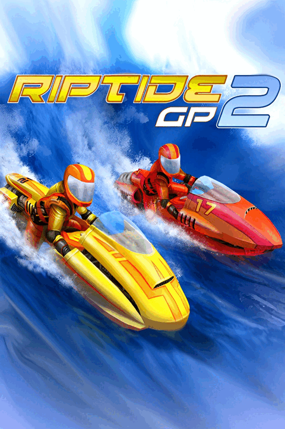

# Riptide GP2 - Port for R36S

## English

Riptide GP2 running natively on the R36S. Original Android ARM64 engine, on
SDL3 and FMOD, GLES2 resolved at runtime, and an ultra low profile so it
fits 512MB and 1GB cards.

Tested on R36S with DarkOS EN.

### Install

1. Copy `Riptide GP2.sh` and the `riptidegp2` folder into your `ports` folder.
2. Drop the Riptide GP2 file you own into `ports/riptidegp2/gamedata/`. Any file name works.
3. Open it once. It extracts and starts.

You need an aarch64 firmware with glibc 2.27 or newer, GLES2, roughly 400MB
free on the first run, and 640x480.

There is no game data here. Bring your own copy.

### Which APK works

Tested with `2026.10.03`, versionCode 77.

| | |
|---|---|
| Package | `com.vectorunit.red` |
| Version | `2026.10.03` (versionCode 77) |
| ABI | `arm64-v8a` |
| XAPK size | 105662663 bytes |
| XAPK SHA-256 | `cd57979720829a5463c471fbf346711b117fa6222e4b58758a71cf5fb4233a23` |
| Base APK SHA-256 | `fc3a91eadc0dd213ae60314a9b91cec94c38bb0ebadb1cad7ee8f754188c11b2` |
| ABI split SHA-256 | `e3de83cef9b3f08b0746429424d4a7f8d934c0ee7815821803ba4c24480a7509` |

Reference file `Riptide+GP2_2026.10.03.xapk`. Other builds of the
same package are accepted as long as the engine and the assets pass
validation.

Installed payload is about 54.3 MiB. If you put only the base APK the port
refuses, because the engine lives in the ARM64 split.

### Controls

Native gamepad.

| | |
|---|---|
| Steer | D pad and/or left stick |
| Stunts | both sticks together |
| Nitro, confirm | `A` |
| Back | `B` |
| Accelerate (manual mode) | `R1` `R2` |
| Brake | `L1` `L2` |
| Free | `R3` |
| Pause | `START` |
| Exit | `SELECT` and `START` |

At the start of a race the game asks for automatic or manual acceleration.
Automatic is the better choice. The jetski accelerates on its own and both
sticks stay free for steering and stunts.

## Português

Riptide GP2 rodando nativo no R36S. Engine ARM64 original do Android, em
SDL3 e FMOD, GLES2 resolvido em runtime, e um perfil ultra low para caber
em cards de 512MB e 1GB.

Testado em R36S com DarkOS EN.

### Instalação

1. Copie `Riptide GP2.sh` e a pasta `riptidegp2` para a sua pasta `ports`.
2. Coloque o arquivo de Riptide GP2 que você tem em
   `ports/riptidegp2/gamedata/`. O `.xapk` é o mais fácil. Qualquer nome de arquivo funciona.
3. Abra uma vez. Ele extrai e inicia.

Você precisa de um firmware aarch64 com glibc 2.27 ou mais nova, GLES2,
uns 400MB livres na primeira vez, e 640x480.

Aqui não tem dado de jogo. Traga o seu.

### Qual APK funciona

Testado com `2026.10.03`, versionCode 77.

| | |
|---|---|
| Pacote | `com.vectorunit.red` |
| Versão | `2026.10.03` (versionCode 77) |
| ABI | `arm64-v8a` |
| Tamanho do XAPK | 105662663 bytes |
| SHA-256 do XAPK | `cd57979720829a5463c471fbf346711b117fa6222e4b58758a71cf5fb4233a23` |
| SHA-256 do APK base | `fc3a91eadc0dd213ae60314a9b91cec94c38bb0ebadb1cad7ee8f754188c11b2` |
| SHA-256 do split ABI | `e3de83cef9b3f08b0746429424d4a7f8d934c0ee7815821803ba4c24480a7509` |

Arquivo de referência `Riptide+GP2_2026.10.03.xapk`. Outras versões
do mesmo pacote são aceitas desde que a engine e os assets passem na
validação.

O payload instalado fica em torno de 54,3 MiB. Se você colocar só o APK
base o port recusa, porque a engine fica no split ARM64.

### Controles

Gamepad nativo, sem cursor na tela.

| | |
|---|---|
| Pilotar | direcional e/ou analógico esquerdo |
| Manobras | os dois analógicos juntos |
| Nitro, confirmar | `A` |
| Voltar | `B` |
| Acelerar (modo manual) | `R1` `R2` |
| Frear | `L1` `L2` |
| Livre | `R3` |
| Pausa | `START` |
| Sair | `SELECT` e `START` |

No começo da corrida o jogo pergunta se a aceleração é automática ou
manual. Automática é a melhor opção. O jetski acelera sozinho e os dois
analógicos ficam livres para pilotar e fazer manobras.

---

Cover art belongs to Vector Unit and is here only to show
the port (<https://www.vectorunit.com/riptide-gp2>). No game data included.
